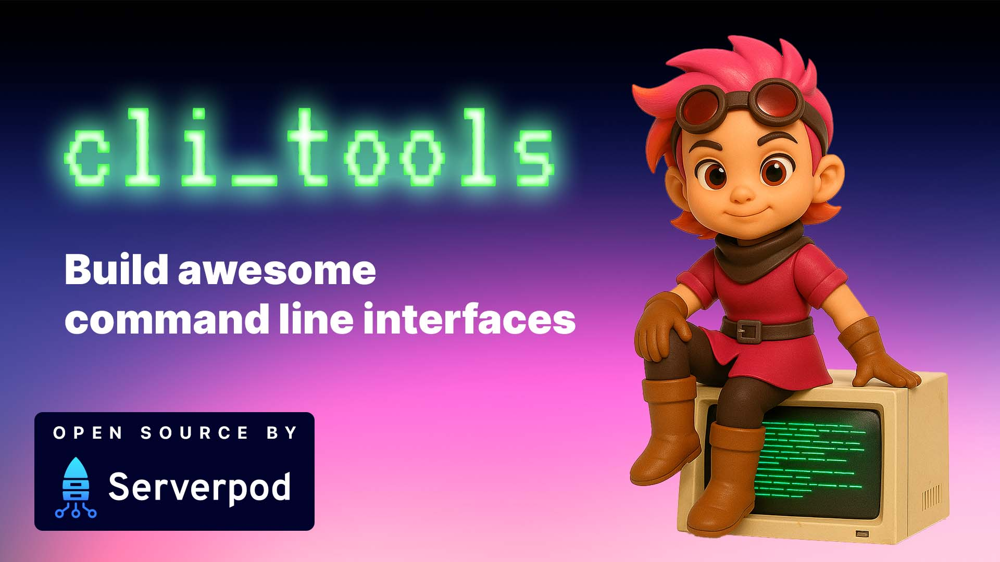

[](https://github.com/serverpod/serverpod)

# CLI Tools

This package contains tools for building great command line interfaces.
These tools were developed for the Serverpod CLI but can be used in any Dart project.

## BetterCommandRunner

`BetterCommandRunner` is the starting point for a command line application.
It extends the `CommandRunner` of the [config](https://pub.dev/packages/config) package,
which provides the command framework itself:

- a tree of commands and subcommands,
- typed options, resolved from the command line, environment variables, and configuration files,
- middlewares that run before and after commands,
- generated `--help` and usage output,
- shell completion.

On top of that, `BetterCommandRunner` adds:

- **Standard global options.** `--quiet` and `--verbose`, plus `--[no-]analytics` when analytics is set up.
  Pass your own `globalOptions` to replace or extend them.
- **Log level.** The `setLogLevel` callback is called with the level from `--quiet` and `--verbose` before the command runs.
- **Analytics.** The `onAnalyticsEvent` callback is called with the name of the command that is run.
  Override `determineAnalyticsSettings` to decide whether events are sent, for example to ask the user for consent.
- **Usage by default.** Running the executable without a command prints the usage.

`BetterCommand` is the matching base class for commands.

### Usage

Define the options of a command as an enum, and read their values from the context in `run`:

```dart
import 'dart:io' show exit;

import 'package:cli_tools/cli_tools.dart';
import 'package:config/command.dart';
import 'package:config/config.dart';

enum GreetOption<V extends Object> implements OptionDefinition<V> {
  name(StringOption(argName: 'name', argPos: 0, mandatory: true)),
  shout(FlagOption(argName: 'shout', defaultsTo: false));

  const GreetOption(this.option);

  @override
  final ConfigOptionBase<V> option;
}

class GreetCommand extends BetterCommand<GreetOption, void> {
  GreetCommand() : super(options: GreetOption.values);

  @override
  String get name => 'greet';

  @override
  String get description => 'Greets someone.';

  @override
  void run(final CommandContext<GreetOption, void> context) {
    final name = context.config.value(GreetOption.name);
    final greeting = 'Hello $name';
    final shout = context.config.value(GreetOption.shout);
    context.provider.fetch<Logger>().info(
      shout ? greeting.toUpperCase() : greeting,
    );
  }
}

Future<void> main(final List<String> args) async {
  final runner = BetterCommandRunner<StandardGlobalOption, void>(
    'example',
    'An example command line application.',
  )..addCommand(GreetCommand());

  // A middleware runs before the commands, and shares objects with them
  // through the context.
  runner.addMiddleware(
    Middlewares.onBeforeRun((final context) {
      final verbose = context.config.value(StandardGlobalOption.verbose);
      context.provider.store<Logger>(
        StdOutLogger(verbose ? LogLevel.debug : LogLevel.info),
      );
    }),
  );

  try {
    await runner.run(args);
  } on UsageException {
    // The usage error has already been printed.
    exit(1);
  }
}
```

```sh
example greet World --shout
example --verbose greet World
example greet --help
```

See [example/main.dart](https://github.com/serverpod/cli_tools/blob/main/packages/cli_tools/example/main.dart)
for a complete example.

### Further reading

Commands, options, middlewares, action options such as `--version`, usage output, and
shell completion are all features of the `config` package. See:

- [The command framework](https://github.com/serverpod/cli_tools/blob/main/packages/config/README_command.md), for `CommandRunner` and `Command`.
- [The config package](https://github.com/serverpod/cli_tools/blob/main/packages/config/README.md), for options and configuration sources.

## Migrating to BetterCommand/Runner 0.15

Version 0.15 replaces the legacy `args` package with the new `CommandRunner`
framework of the `config` package.

To make it easy to upgrade from earlier version of BetterCommandRunner,
there is an agent skill for migrating your code for you.

```sh
# One-time: activate the CLI (make sure ~/.pub-cache/bin is on your PATH)
dart pub global activate skills
```

Update dependencies:
```yaml
  cli_tools: ^0.15.0
  config: ^1.0.0
```


Install the skill `cli_tools-migrate-better-command-runner`, from your repo root:
```sh
skills get --package cli_tools
```

Possibly create a new agent chat so that new skills get included.
Prompt your agent to perform the migration by pointing it at your CLI tool package:
```
/cli_tools-migrate-better-command-runner packages/my_tool
```

## Config library

The `config` library has been moved into its own package, published on pub.dev as [config](https://pub.dev/packages/config).

## Contributing to the Project

We are happy to accept contributions. To contribute, please do the following:

1. Fork the repository
2. Create a feature branch
3. Commit your changes
4. Push to the branch
5. Create a pull request
6. Discuss and modify the pull request as necessary
7. The pull request will be accepted and merged by the repository owner

Tests are required to accept any pull requests.

See also [CONTRIBUTING](/CONTRIBUTING.md).
